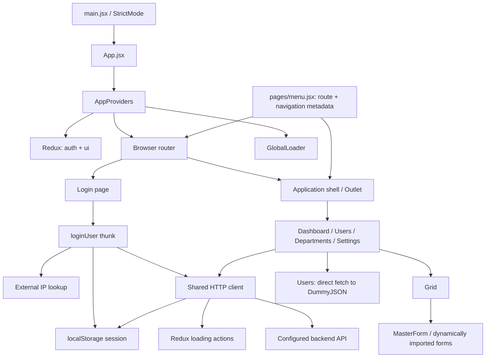

# Application Architecture Review: The Good and the Bad

**Application:** `client-react-app`  
**Reviewed:** 11 October 2026  
**Scope:** Current frontend working tree, including existing modified and untracked application files.

## Overall assessment

The application has a useful foundation for a small internal management system: a common application shell, centralized route metadata, Redux for shared state, reusable table and input components, and a shared HTTP client. The production build succeeds.

The implementation does not yet consistently follow its documented feature-first architecture. Business behavior sits in pages, generic components live under `app/core`, and shared modules depend on application configuration and Redux slices. Authentication, session handling, data fetching, and the new form framework need attention before relying on this foundation for production workflows.

**Recommendation:** Keep the existing React/Redux foundation and improve it incrementally. Address authentication and sensitive logging first, complete one end-to-end CRUD feature, then use that feature to establish enforceable module boundaries.

This is a frontend architecture review, not a backend security assessment. No backend source or live API behavior was reviewed. Missing client-side guards do not establish whether the backend permits unauthorized operations.

## Current architecture



The diagram shows the main connections. The Users page currently uses direct `fetch`, while Departments uses the shared client.

| Area | Current responsibility |
| --- | --- |
| `app/providers`, `app/router` | Root composition and browser routing |
| `app/core` | Application layout, table behavior, parameter inputs, form loading |
| `app/forms` | Department form and form metadata |
| `pages/views`, `pages/menu.jsx` | Screens, fetching/filtering, navigation and route registration |
| `store` | Authentication state, login thunk, global request counter |
| `shared` | HTTP transport, browser/device helpers, common UI, CSS |
| `features`, `entities` | Documented folders containing README placeholders |

## The Good

### 1. Clear application entry and provider composition

[main.jsx](../src/main.jsx), [App.jsx](../src/App.jsx), and [AppProviders.jsx](../src/app/providers/AppProviders.jsx) form a small, understandable bootstrap chain. Routing, Redux, and the global loader are composed in one place. `StrictMode` is enabled.

**Benefit:** App-wide integrations have an obvious home, and individual screens do not need to configure providers.

### 2. Navigation and route definitions share metadata

[menu.jsx](../src/pages/menu.jsx) supplies paths, labels, groups, icons, and page elements. [router.jsx](../src/app/router/router.jsx) builds its child routes from that list; [application.jsx](../src/app/core/application.jsx) uses it for navigation.

**Benefit:** Adding a visible module usually means updating one registry instead of separately maintaining sidebar and route lists. This is practical at the current scale, although the registry should eventually move into application composition.

### 3. Shared state and temporary UI state are mostly separated

[authSlice.js](../src/store/authSlice.js) manages session information and login status. [uiSlice.js](../src/store/uiSlice.js) tracks API loading. The login screen keeps typing, validation feedback, and password visibility local.

**Benefit:** Transient form interactions do not unnecessarily become global Redux state. Selectors provide a consistent interface for consumers.

### 4. Common HTTP behavior is already centralized

[httpClient.js](../src/shared/api/httpClient.js) handles API URL composition, authorization headers, query parameters, HTTP status errors, and network error messages.

The loading counter is decremented in `finally`, and [uiSlice.js](../src/store/uiSlice.js) counts active requests rather than toggling a single boolean.

**Benefit:** Overlapping requests through this client can keep the loader active until all finish. Transport fixes can be applied centrally once all production fetching follows this path.

### 5. Reusable table and form primitives reduce duplication

[grid.jsx](../src/app/core/grid.jsx) supports configurable columns, rendering, sorting, search, selection, resizing, and toolbar callbacks. [parameter-input.jsx](../src/app/core/parameter-input.jsx) standardizes labeled input/select controls.

[master_form.jsx](../src/app/core/master_form.jsx) loads form modules on demand through `import.meta.glob`, handles loading/import errors, and ignores obsolete import results after effect cleanup.

**Benefit:** New management screens can reuse established behavior. The build confirms a separate Department form chunk, so form code is actually split from the main bundle.

### 6. Design tokens and automated checks exist

[tokens.css](../src/shared/styles/tokens.css) defines reusable design variables. [eslint.config.js](../eslint.config.js) checks JavaScript, React Hooks, compiler compatibility, and Fast Refresh. [package.json](../package.json) provides build and lint commands.

**Benefit:** There is already a base for consistent styling and automated quality gates. The configured checks are currently finding real problems.

## The Bad

Priority meanings: **High** means address before production use or extending the affected workflow; **Medium** means address as the application grows. These are engineering priorities, not vulnerability severity scores.

### 1. Application routes are not guarded — High

**Evidence:** [router.jsx](../src/app/router/router.jsx), lines 7–25, mounts `Application` and its child routes without an authentication check. [authSlice.js](../src/store/authSlice.js), line 125, defines `selectIsAuthenticated`, but no consumer was found.

**Impact:** A signed-out user can navigate directly to application routes and render their screens. Logout redirects to login but does not prevent returning to these URLs. No permission checks are present in route/menu composition either.

**Improve:** Add an authentication boundary around the application branch, a session-restoration state, and an intentional expired-session flow. Add permission metadata where roles require it. Verify that the backend independently authorizes every protected operation; a browser guard only controls frontend access and navigation.

### 2. Session handling has competing state sources and unclear persistence — High

**Evidence:** [authSlice.js](../src/store/authSlice.js), lines 20–32 and 96–110, persists every successful login to `localStorage`, even when `remember` is false. [httpClient.js](../src/shared/api/httpClient.js), lines 12–36, reads the token directly from storage instead of current Redux state. Both files duplicate the storage key and session-reading logic.

**Impact:** Redux and persistent storage can disagree, especially after external storage changes or future token refresh work. The UI's Remember me option does not control persistence. There is no implemented startup session validation or central response to HTTP 401. JavaScript-readable persistent tokens increase the consequences of an XSS flaw; this review did not establish that such a flaw exists. [OWASP guidance](https://cheatsheetseries.owasp.org/cheatsheets/HTML5_Security_Cheat_Sheet.html)

**Improve:** Define one session lifecycle and one persistence adapter. Honor the chosen persistence policy and synchronize session changes. Evaluate a backend-supported HttpOnly cookie design with appropriate CSRF controls; otherwise document and minimize bearer-token exposure. Establish expiry/401 behavior before adding refresh logic.

### 3. Login logs credentials and the authentication result — High

**Evidence:** [login.jsx](../src/pages/views/login.jsx), line 76, logs the complete action returned from `dispatch(loginUser(formValues))`. The thunk is passed the password, and its successful payload includes the token. Redux Toolkit lifecycle actions retain the thunk argument in `meta.arg`. [Redux Toolkit reference](https://redux.js.org/toolkit/api/createAsyncThunk)

**Impact:** That console log can expose the submitted password and returned token to anyone or any debugging/telemetry process inspecting console output.

**Improve:** Remove the complete action log. Define a logging policy that excludes passwords, session tokens, and raw authentication actions. If authentication actions are inspected by development tools, sanitize their payloads and metadata.

### 4. The documented layer boundaries do not match the code — Medium

**Evidence:** [README.md](../README.md) declares `pages -> widgets -> features -> entities -> shared` and asks that `shared` remain independent. However:

- [httpClient.js](../src/shared/api/httpClient.js) imports `app/config` and `store/uiSlice`.
- [GlobalLoader.jsx](../src/shared/ui/GlobalLoader.jsx) imports Redux hooks and selectors.
- [users.jsx](../src/pages/views/users.jsx) imports generic table/input components from `app/core` and owns fetching/filter logic.
- [application.jsx](../src/app/core/application.jsx) imports the page-layer menu registry.
- `features` and `entities` currently contain documentation placeholders rather than implementation.

**Impact:** Folder names suggest stronger separation than exists. Shared components are tied to one application and one store, while new business behavior is likely to accumulate in pages and `app/core`. No import-boundary rules enforce the stated convention.

**Improve:** Make `app` the composition layer. Put generic table/input/dialog UI in `shared`, shell blocks in `widgets`, use cases in `features`, and domain mapping/API contracts in `entities` where useful. Inject URL configuration, token access, and request lifecycle callbacks into the transport. Keep a Redux-connected loader wrapper above a presentational shared loader. Enforce the selected dependency rules with lint rules and update the README to match.

### 5. Reducers perform persistence side effects — Medium

**Evidence:** [authSlice.js](../src/store/authSlice.js), lines 86 and 104, calls `persistSession` inside logout and login-fulfilled reducers.

**Impact:** State transitions also write to browser storage. This makes reducer tests and replay harder to reason about, and storage failures can interrupt action processing. Storage reads catch failures; these writes do not.

**Improve:** Move persistence to listener middleware or another session adapter invoked outside reducers. Handle storage failure explicitly. Redux recommends keeping reducers free of side effects. [Redux style guide](https://redux.js.org/style-guide/)

### 6. Data fetching and failure handling are inconsistent — High for existing workflows

**Evidence:** [users.jsx](../src/pages/views/users.jsx), lines 22–34, calls DummyJSON directly, skips `response.ok`, and reports failures only to the console. [departments.jsx](../src/pages/views/departments.jsx), lines 7–19, requests departments but only logs the response; `setDepartments` is never called and grid loading is hardcoded to false at line 32.

**Impact:** Departments remains empty even after a successful response. Users bypasses centralized error/loading behavior, and failed requests can appear as empty data. Neither page cancels its request on cleanup. No shared caching or invalidation policy exists.

**Improve:** Complete Departments with response mapping, loading, error, and retry states. Move production endpoints and mapping out of screens. Choose a consistent fetching lifecycle with cancellation and explicit empty/error states. Consider RTK Query when shared caching and invalidation are needed; it is already available through Redux Toolkit. [Redux Toolkit guidance](https://redux.js.org/toolkit/api/createAsyncThunk)

### 7. The form framework has no complete save contract — High for CRUD

**Evidence:** [master_form.jsx](../src/app/core/master_form.jsx), lines 209–214, renders Save without a click or submit handler. [departments.jsx](../src/app/forms/departments.jsx), line 11 onward, does not use its `mode`, `record`, or `onClose` props. Its input is not connected to record state or persistence.

**Impact:** Add/Open/Edit can display a form shell, but Save cannot persist a record. Open mode does not currently make the Department input read-only. The Grid owns both table behavior and form workflow, so generic table changes become coupled to module form behavior.

**Improve:** Define who owns values, validation, submission, errors, dirty state, and post-save refresh. Give the actual form a submit mechanism and let feature composition connect table actions to forms. Hide or disable unavailable actions. Complete one Department add/edit/save/refetch flow before expanding the framework.

### 8. Grid identity and scale assumptions are fragile — Medium

**Evidence:** [grid.jsx](../src/app/core/grid.jsx), lines 47–52, falls back to row index when the configured key is absent. Selection resolves those indexes against filtered/sorted rows at lines 113–120. All filtered rows are rendered at line 411; no pagination or virtualization is implemented.

**Impact:** With missing IDs, selecting row index 0 and then sorting can move the selection to a different record. A small isolated check reproduced Beta becoming Alpha under this fallback. This is a correctness issue in the generic component, not proof that current API records lack IDs. Large datasets also increase browser sorting, filtering, rendering, and selection costs.

**Improve:** Require a stable, unique record key and report missing/duplicate identities. Clarify whether selection persists across filtering. Add server pagination for large datasets and virtualization if measured rendering cost requires it. Fix dependencies involving `getRowId`; lint currently flags the selection memoization. React also documents the hazards of index-based identity. [React list guidance](https://react.dev/learn/rendering-lists)

### Other architectural weaknesses — Medium

| Area | Evidence and consequence | Improvement |
| --- | --- | --- |
| Error containment | [router.jsx](../src/app/router/router.jsx) has no custom `errorElement`, explicit catch-all route, or application error boundary. Users/Departments do not display fetch errors. | Add intentional not-found and error screens, plus recoverable feature error states. |
| Global loading policy | Every shared-client request activates [GlobalLoader.jsx](../src/shared/ui/GlobalLoader.jsx); [global.css](../src/shared/styles/global.css), line 1101, places it over the full viewport. | Distinguish blocking operations from background refresh and local list loading. Add bounded request timeouts so a hanging request cannot hold the overlay indefinitely. GET accepts fetch options, but POST exposes no options parameter for cancellation. |
| Third-party login dependency | [authSlice.js](../src/store/authSlice.js), line 37, awaits [getIpAddress](../src/shared/core/common.jsx) before login. That external fetch has no timeout. | Prefer the server-observed address where appropriate, or make optional client metadata bounded and nonblocking. A rejection falls back to null, but a slow unresolved request still delays login. |
| Form accessibility | [master_form.jsx](../src/app/core/master_form.jsx) uses a full-screen overlay without dialog semantics, focus trapping/restoration, or Escape handling. Grid selection inputs lack accessible labels. | Make the dialog and table controls accessible once in the shared components, then reuse that behavior across modules. |
| Module loading | [menu.jsx](../src/pages/menu.jsx) statically imports all route pages. Form loading depends on path strings such as `forms/departments`. | Add route-level lazy loading as modules grow. Use an explicit form registry or checked contracts so renames do not become runtime import errors. |
| Contracts and styling | Source uses JavaScript without TypeScript/JSDoc contracts or response validation. Domain fields, form metadata, and column options are implicit. CSS tokens coexist with hardcoded colors and utility classes. | Add focused contracts for API responses, row IDs, columns, and form props. Apply a consistent token policy without requiring a wholesale rewrite. |
| Maintenance and tooling | Unused `apiLoadingStore.js` duplicates Redux loading state; `AppNav.jsx` is unused. [README.md](../README.md) and [REDUX_NOTES.md](../REDUX_NOTES.md) contain stale paths/assumptions. Package engines allow Node 20.0, while installed Vite requires 20.19+ in the Node 20 line. `.env` is tracked. | Remove obsolete paths, update docs, and align the Node requirement. Define deliberate environment-file handling and an example config. No secret leak was established; Vite client environment values are public build inputs. [Vite environment guidance](https://vite.dev/guide/env-and-mode) |

## Recommended order of work

1. **Authentication and logging:** Remove sensitive logs; guard application routes; define restoration, persistence, and expired-session behavior; verify backend authorization.
2. **Complete Departments:** Store returned data; show loading/errors; implement validated add/edit/save; refresh the list after success; disable unavailable actions.
3. **Stabilize shared behavior:** Require stable row keys, resolve Hook/compiler lint errors, move storage writes out of reducers, and establish one request lifecycle.
4. **Enforce boundaries:** Move generic components out of `app/core`, put business behavior in feature/domain modules, and inject app-specific dependencies into shared services.
5. **Add focused regression protection:** Cover signed-out direct navigation, session persistence choices, concurrent request counters, failed saves, and selection after sorting/filtering. Establish build/lint/test checks in CI.
6. **Improve growth readiness:** Add error boundaries, accessible dialogs, route splitting, pagination when needed, configuration validation, and accurate maintenance documentation.

## Suggested direction

```text
src/
  app/                 # providers, router, module registry, configuration
  widgets/             # application shell, sidebar, connected loader
  pages/               # route composition
  features/            # login, department editing, user filtering
  entities/            # session/user/department models and API mapping
  shared/              # independent HTTP transport, grid, inputs, dialog, tokens
```

`app` composes the layers. Pages and widgets consume feature/domain behavior; shared modules accept dependencies through explicit interfaces. Keep local form state local and use Redux only when state needs to be shared. Introduce additional domain modules when there is real domain behavior to place there.

## Verification and limits

| Check | Result |
| --- | --- |
| Discovery | Repository indexed and inspected using the codebase knowledge graph; source/config inspection supplemented incomplete graph coverage. |
| Production build | `npm run build` passed on Node `v20.19.5`, npm `10.8.2`. Main JavaScript: 351.71 kB / 113.38 kB gzip; Department form: separate 0.84 kB chunk. These are build sizes, not measured loading performance. |
| Lint | `npm run lint` failed: **16 errors, 3 warnings**. Errors include Grid compiler/memoization and effect diagnostics, MasterForm effect diagnostics, form metadata Fast Refresh compatibility, and unused code. |
| Row identity spot check | Isolated fallback-index sorting example changed selected record from Beta to Alpha. |
| Automated tests / CI | No test script, test/spec files, or repository CI configuration was found. No browser end-to-end test was performed. |
| Backend / deployment | API authorization, response contracts, token expiry, hosting history fallback, and production configuration were not verified against a running service. |

Existing local changes were included in the findings. Application source was not edited during this review. A passing build establishes bundling success; it does not establish complete workflows, authorization, or production readiness.
